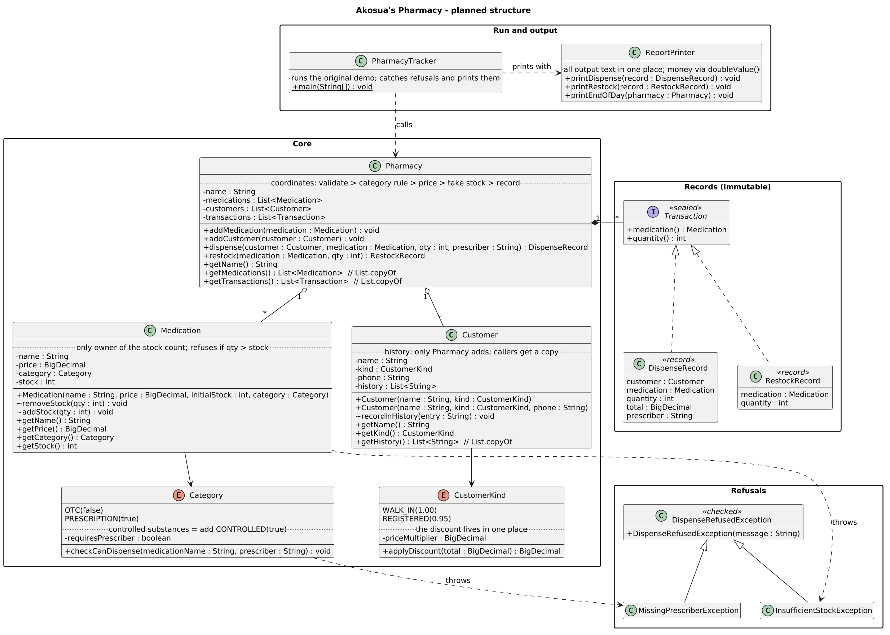
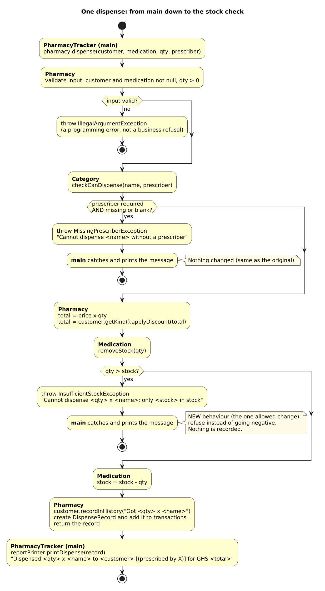

# Diagnosis: Akosua's Pharmacy tracker

This diagnosis covers the original `PharmacyTracker.java` as delivered (commit `236f83f`).
The original output, saved before any change, is in `evidence/original-output.txt`.

## The most dangerous problem

**Stock counts can go below zero (problem 1).** The baseline run shows it directly: Amoxicillin
ends the day at **-61 in stock**, because a request for 100 was accepted when only 39 were left.
In a pharmacy, the stock count is how staff know what medicine physically exists. A wrong count
means medicine is sold and paid for that isn't on the shelf, reorders aren't triggered when they
should be, and nobody can say where medication has gone. Losing track of medication is a
patient-safety and legal issue, not an inconvenience. It is the reason Akosua stopped trusting
the program.

It is ranked above problem 2 (public fields) only because it is already happening. Problem 2 is
almost as serious: even after a stock check is added, public fields would let any other code
bypass it. Both must be fixed together.

---

## Ranked problems

### 1. Stock can go below zero
- **Where:** `Pharmacy.dispense`, lines 117 and 129 (`m.stock = m.stock - qty`). Also
  `Pharmacy.restock`, line 138.
- **Root cause:** stock is reduced without first checking that there is enough
  (`qty <= stock`). Nothing anywhere enforces the rule that a count can never be negative.
  `restock` and `dispense` also accept negative quantities: `restock(m, -50)` silently
  removes stock, and `dispense(..., -5, ...)` adds it.
- **Risk to the pharmacy:** a transaction can be made and paid for when the stock isn't
  there, which at minimum damages the pharmacy's reputation. More seriously, the pharmacy loses
  track of its medication: the count no longer matches the shelf, reordering can't be relied on,
  and medication can be handed out without the records showing where it went.

### 2. Encapsulation is broken: public fields and a returned internal list
- **Where:** every field in `Medication` (lines 38–42), `Customer` (lines 56–60) and
  `Transaction` (lines 72–77), and `Pharmacy.meds` and `Pharmacy.customers` (lines 93–94) are
  public. `getTransactions()` (lines 143–145) returns the internal list itself, not a copy.
  `main` already writes to a field directly (`ama.phone = ...`, line 21).
- **Root cause:** classes expose their data instead of protecting it behind methods that
  enforce the rules. Any code can write `m.stock = -5`, change a medicine's category, edit a
  patient's history, or clear or add to the transaction list.
- **Risk to the pharmacy:** no rule can be relied on, because any code can go around it. Patient
  history, transaction records and stock can be changed without a trace. For a business that
  holds patient information and controls medication, the records must not be editable from
  anywhere. 

### 3. The prescriber is barely checked and never stored
- **Where:** `Pharmacy.dispense`, line 121 (`if (prescriber == null)`). The prescriber is
  printed on line 131 but not saved in the transaction (line 134) or the history (line 133).
- **Root cause:** the check only rejects `null`, so an empty or blank name (`""`) passes. After
  the check, the prescriber is thrown away.
- **Risk to the pharmacy:** prescription-only medicine can be given out with a meaningless
  prescriber, and there is no record of who authorised any prescription. That is a legal and
  audit gap. The coming controlled-substances category requires every dispense to record the
  prescriber, and the current design has nowhere to put it.

### 4. Category and customer kind are free-text Strings, and unknown values are silently ignored
- **Where:** `Medication.category` (line 41), `Customer.kind` (line 57), `Transaction.type`
  (line 77), and the `.equals(...)` checks in `dispense` (lines 112, 114, 120, 126). The
  `if / else if` on lines 112–132 has no final `else`.
- **Root cause:** any String compiles, so a typo such as `"Prescription"` or `"Registered"` is
  accepted. In `dispense`, a category that matches neither branch skips the price, the
  prescriber check and the stock update, but lines 133–134 still run, because they are outside
  the `if`.
- **Risk to the pharmacy:** one typo means a prescription medicine can be dispensed **with no
  prescriber check**, recorded as a **GHS 0** sale, with the stock **not reduced**. Nothing
  warns anyone. A typo in the customer kind silently loses a registered patient's discount.
  This risks illegal dispensing, lost money and lost trust.

### 5. Input is not validated, and failures are silent
- **Where:** every public method: `dispense`, `restock` and the constructors. The prescriber
  refusal (lines 121–124) prints a message and returns.
- **Root cause:** nothing rejects a zero or negative quantity, a negative price or stock, or a
  `null` customer or medication. When a dispense is refused, the method prints and returns
  normally, so the calling code cannot tell that it failed.
- **Risk to the pharmacy:** a negative quantity records a **negative total**, which works like an
  unrecorded refund, so the money records can't be trusted. Because refusals print and return
  instead of failing, the calling code believes a refused dispense succeeded, and errors are
  missed instead of dealt with.

### 6. Shared logic is copied into each category branch
- **Where:** `Pharmacy.dispense`: lines 113–117 and 125–129 are the same price, discount and
  stock-reduction code, written twice.
- **Root cause:** the rules that differ between categories (only the prescriber check) are not
  separated from the rules that are the same for every category, so the shared steps were
  copied.
- **Risk to the pharmacy:** this is the cause of the reported problem, *"a change to one kind
  of medicine quietly broke another."* If the discount is changed in one branch and not the
  other, one kind of medicine is priced wrongly with no error. Every fix, including the stock
  rule, has to be made in two places, and controlled substances would add a third copy.

### 7. Records store name strings instead of the customer and medication
- **Where:** `Transaction.customerName` and `Transaction.medName` (lines 73–74). The `id`
  fields (lines 42, 59, 72) are created but never used.
- **Root cause:** a transaction copies the names rather than referring to the actual customer
  and medication.
- **Risk to the pharmacy:** two customers with the same name cannot be told apart. A
  prescription medicine could be recorded against a patient who has no prescription, or a
  customer could be linked to a purchase they didn't make. The records can't be traced reliably
  in an audit.

### 8. Money is stored as `double`
- **Where:** `Medication.price` (line 39), `Transaction.total` (line 76), and the total
  calculation in `dispense` (lines 111–127).
- **Root cause:** `double` cannot represent many decimal values exactly (for example 0.95), so
  calculations pick up small rounding errors.
- **Risk to the pharmacy:** the price charged can differ slightly from the correct price, and
  the difference grows with larger prices, quantities and daily totals.

### 9. One class does everything
- **Where:** `Pharmacy` (lines 91–156) handles pricing, discounts, the prescription rule, stock
  changes, customer history, transaction records and printing. Everything is in one file.
- **Root cause:** responsibilities are not separated, so one class has many reasons to change.
- **Risk to the pharmacy:** every change means editing the class that does everything else, so
  the code is easy to break and hard to fix. Adding controlled substances would mean editing
  the core again, which is the "another rewrite" Akosua does not want.

### 10. History is kept for every customer, including walk-ins
- **Where:** `Pharmacy.dispense`, line 133.
- **Root cause:** history is added for every customer, whatever their kind.
- **Risk to the pharmacy:** the brief says the pharmacy keeps history for **registered
  patients**. Walk-ins' data is stored without need, and patient history and the transaction
  log are mixed up.

---
## Design sketch

