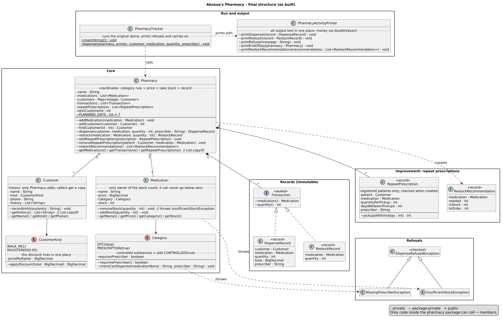
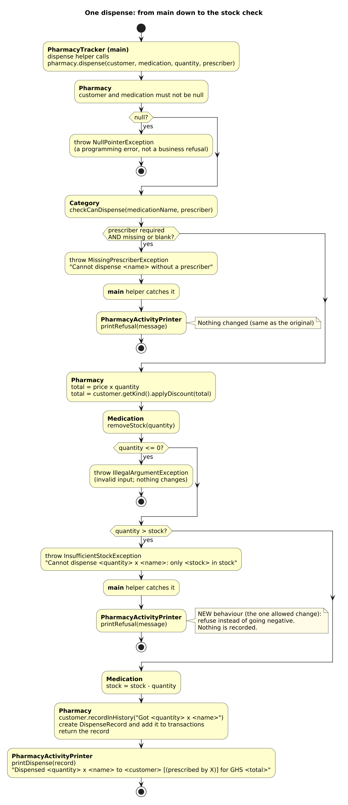

# Akosua's Pharmacy: Stock and Dispensing Tracker

A small in-house program that Akosua's pharmacy uses to track what is in stock and what gets
dispensed. The original single file worked but had become risky to change, and stock could go
negative. This version is a rebuild: it behaves exactly as the original does, except that
**stock can never go below zero**. It is split into small classes, so each rule lives in one
place and outside code cannot put the pharmacy into an invalid state.

- **Diagnosis** of the original: [`DIAGNOSIS.md`](DIAGNOSIS.md) (committed before any code change)
- **Evidence** that behaviour is preserved: [`evidence/`](evidence/)
- **Diagrams**: [`docs/diagrams/`](docs/diagrams/) (`class-diagram` and `dispense-flow` are the
  original sketch; `final-class-diagram` and `final-dispense-flow` show the code as built)

## Running it

You need **JDK 21**. The code is in the `pharmacy` package.

**With Maven:**

```bash
mvn compile
mvn exec:java -Dexec.mainClass=pharmacy.PharmacyTracker
```

**Or directly with the JDK:**

```bash
javac -d target/classes $(find src/main/java -name "*.java")
java -cp target/classes pharmacy.PharmacyTracker
```

**Tests** (JUnit 5, 20 tests):

```bash
mvn clean test
```

**Improvement demo** (shows the restock recommendations; it lives in the test folder so the
main program's output is unchanged):

```bash
mvn test-compile
java -cp "target/classes;target/test-classes" pharmacy.RepeatPrescriptionDemo   # Windows
java -cp "target/classes:target/test-classes" pharmacy.RepeatPrescriptionDemo   # macOS/Linux
```

GitHub Actions runs `mvn -B test` on every push (`.github/workflows/build.yml`).

## Behaviour: what changed and what didn't

The original output was saved before any change in
[`evidence/original-output.txt`](evidence/original-output.txt). The rebuild's output is in
[`evidence/rebuild-output.txt`](evidence/rebuild-output.txt). Every refactoring step was
checked against these files with `diff`.

```text
Dispensed 2 x Paracetamol 500mg to Kofi Mensah for GHS 25.0
Dispensed 1 x Amoxicillin 250mg to Ama Owusu (prescribed by Dr. Boateng) for GHS 28.5
Restocked 50 x Paracetamol 500mg
Cannot dispense 100 x Amoxicillin 250mg: only 39 in stock

=== Akosua's Pharmacy - end of day ===
Stock levels:
  Paracetamol 500mg (OTC): 148 in stock
  Amoxicillin 250mg (PRESCRIPTION): 39 in stock
Transactions today: 3
```

The only differences from the original all come from the stock rule:

| Original | Rebuild | Why |
|---|---|---|
| `Dispensed 100 x Amoxicillin 250mg to Kofi Mensah ...` | `Cannot dispense 100 x Amoxicillin 250mg: only 39 in stock` | Only 39 are in stock, so the dispense is refused. |
| `Amoxicillin 250mg (PRESCRIPTION): -61 in stock` | `... 39 in stock` | Stock can never go below zero. |
| `Transactions today: 4` | `Transactions today: 3` | A refused dispense changes nothing, so it is not recorded. |

Everything else is identical: the same totals (`25.0`, `28.5`), the same 5% discount for
registered patients, the same prescriber refusal message, the same report layout.
Invalid input that the demo never uses is now rejected (see D7 below).

## Structure



| Group | Classes | Job |
|---|---|---|
| Run and output | `PharmacyTracker`, `PharmacyActivityPrinter` | Runs the original demo; **all** output text lives in the printer, so business classes never print. |
| Core | `Pharmacy`, `Medication`, `Customer`, `Category`, `CustomerKind` | `Pharmacy` coordinates; each other class owns its own data and rule. |
| Records | `Transaction` (sealed), `DispenseRecord`, `RestockRecord` | Immutable facts about what happened. |
| Refusals | `DispenseRefusedException`, `InsufficientStockException`, `MissingPrescriberException` | The business saying no. |
| Improvement | `RepeatPrescription`, `RestockRecommendation` | Stock planning for repeat prescriptions (see below). |

**How protected state is protected:** every field is `private`, and most are `final`. Stock
changes only through `Medication.removeStock` and `addStock`, which refuse anything that
would make it invalid. The customer history and the pharmacy's lists are only ever handed out
as read-only copies (`List.copyOf`). Methods that change state (`recordInHistory`,
`removeStock`, `addStock`) are package-private, so only code inside `pharmacy` can call them.

**How "Pharmacy does too much" was fixed:** stock moved into `Medication`, history into
`Customer`, the discount into `CustomerKind`, the prescriber rule into `Category`, records into
immutable records, and printing into `PharmacyActivityPrinter`. `Pharmacy` is left with one job:
coordinating the order of a dispense.

**The order of one dispense:** check the category's prescriber rule, work out the total, take
the stock, then record it. Both checks run before anything changes, so a refused dispense
leaves stock, history and transactions untouched.



## Design notes

| # | Decision | Why | Alternative I didn't choose |
|---|---|---|---|
| D1 | **Categories are an enum with behaviour.** Each `Category` knows whether it needs a prescriber and checks it itself (`checkCanDispense`). | The rule lives with the category, in one place. A typo like `"Prescription"` no longer compiles, where the original's free-text String silently skipped the check. | A `switch` on the category (every switch must be found and edited); a subclass per category (more classes and inheritance for a single yes/no difference). |
| D2 | **Money is `BigDecimal`**, printed with `doubleValue()`. | `double` has rounding errors. Printing a `BigDecimal` directly gives `25.00` instead of `25.0`, which would change the output. `0.95` is built from a String so it is exact. | Keeping `double`. |
| D3 | **Refusals are checked exceptions.** | The original printed and returned, so the caller couldn't tell a dispense failed. A checked exception makes the compiler force every caller to handle a refusal. `main` catches it in one helper, prints the message and carries on, as the original did. | Unchecked exceptions (easy to forget); returning `null` or `false`. |
| D4 | **History is still recorded for every customer, walk-ins included.** | The original does this, and only the stock rule may change behaviour. If Akosua wants walk-in history dropped, it is a one-line change in `Pharmacy.dispense`. | Recording registered patients only. |
| D5 | **Package `pharmacy`.** | Google Java Style forbids the default package. A short name keeps the folders and run command simple for a single in-house program. | `com.amalitech.pharmacy`: the reversed-domain convention matters for shared libraries, not this program. |
| D6 | **The improvement is a business feature** (repeat-prescription restock recommendations), plus tests and CI. | It uses data the pharmacy already holds to stop patients leaving empty-handed. Tests and CI protect everything else. | Tests alone (useful, but they help the developer, not the pharmacy). |
| D7 | **Invalid input is rejected**: zero or negative quantities, a negative price, negative stock and blank names throw `IllegalArgumentException`; a missing object throws `NullPointerException`. A **blank** prescriber now counts as missing, so it is refused like a null one. | In the original, a negative dispense added stock and `""` counted as a prescriber. Invalid input is a programming error, not a business refusal, so it uses a different exception. The demo never uses such values, so the output is unchanged. | Keeping the defects to match the original exactly. |
| D8 | **The output class is `PharmacyActivityPrinter`.** | It prints every dispense, restock and refusal as it happens, as well as the end-of-day report. | `ReportPrinter` (the name in my sketch): "report" suggested only the end-of-day summary. |

**What changed from the sketch in `DIAGNOSIS.md`:**
- The package is `pharmacy`, not `com.amalitech.pharmacy` (D5).
- `ReportPrinter` became `PharmacyActivityPrinter` (D8). It also gained `printRefusal`, so refusals go through the one output class, and `printRestockRecommendations` for the improvement.
- The original `id` fields and static counters on medications and customers were removed. They were never read, and records now hold the real objects instead of names, so every dispense can be traced.
- Customer IDs were added back, but in `Pharmacy` (a `Map<Integer, Customer>`), as part of the improvement. `addCustomer` returns the ID and `findCustomer(id)` looks a customer up. The pharmacy hands out the IDs, so two pharmacies can't clash through a shared static counter.
- `Category` exposes `requiresPrescriber()`, which the printer uses to choose the message format and `RepeatPrescription` uses for its own check.
- Short names like `m`, `c`, `qty` and `p` were spelled out.

### Adding controlled substances

Add one constant to `Category`:

```java
CONTROLLED(true)
```

Nothing else changes. A prescriber is already checked and stored in every `DispenseRecord`,
the report prints any category by its name, and repeat prescriptions pick up the rule
automatically. If controlled substances later need stricter rules (for example a maximum
quantity per dispense), those go inside `Category` too, still in one place.

In the original, the same change meant copying the whole price, discount and stock block into
a third `else if` branch, adding another free-text String that a typo could silently bypass,
and still having nowhere to store the prescriber.

## Improvement: restock recommendations for repeat prescriptions

**The problem:** registered patients collect the same medicine regularly, for example Ama
every 3 days. If stock runs short, they find out at the counter.

**What it does:** staff record each repeat prescription (patient, medicine, quantity per
pick-up, days between pick-ups, prescriber). `Pharmacy.restockRecommendations()` adds up what
every pick-up in the next 7 days needs for each medicine. For any medicine whose stock won't
cover that, it says how many to order:

```text
Restock needed for repeat prescriptions (next 7 days):
  Amoxicillin 250mg: need 50, have 39, order 11
```

Ama needs 10 every 3 days (3 pick-ups in 7 days, so 30) and Yaw needs 20 weekly (1 pick-up),
so 50 are needed against 39 in stock.

**Key decisions:**
- **Registered patients only.** They are the patients with details on file who come back
  regularly.
- **A plan, not a permission.** A repeat prescription does not authorise a dispense; every
  real dispense still goes through the normal prescriber check. It reuses the same rule
  source, `Category.requiresPrescriber()`, so a prescription-only medicine can't have a
  repeat prescription without a prescriber.
- **Invalid ones can't exist.** `RepeatPrescription` is an immutable record that validates
  itself when created (registered patient, quantities and days above zero, prescriber where
  required).
- **The patient must be this pharmacy's customer**, checked against the customer register.
- **Duplicates are refused** (same patient and same medicine), because a duplicate would
  double-count what is needed and cause over-ordering. To change one, remove it with
  `removeRepeatPrescription` and add the new one.
- **Pick-ups are rounded up** (`pickupsWithin`). Every 3 days in a 7-day window is 3 pick-ups,
  and a monthly prescription still counts once, so stock is never under-planned.
- **Order exactly the shortfall**, with no buffer, so extra stock doesn't sit on the shelf and
  expire.
- **The main program's output is unchanged.** The recommendations are returned as data and
  printed only when asked for (the demo, and the tests).

## Tests

`src/test/java/pharmacy/`:
- `PharmacyTest` (13 tests): the original's totals and discount, stock after a dispense and a
  restock, the stock rule (refused, and exactly-zero allowed), invalid quantities, the
  prescriber rule (missing and blank), protected history and lists, phone numbers, invalid
  objects, and customer IDs.
- `RepeatPrescriptionTest` (7 tests): validation, duplicates, removal, rounding pick-ups, and
  the "order 11" example.
- `RepeatPrescriptionDemo`: the printed example above.